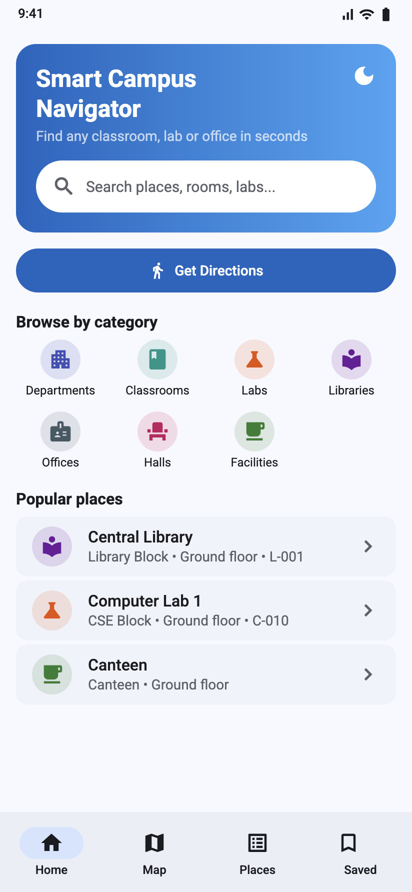
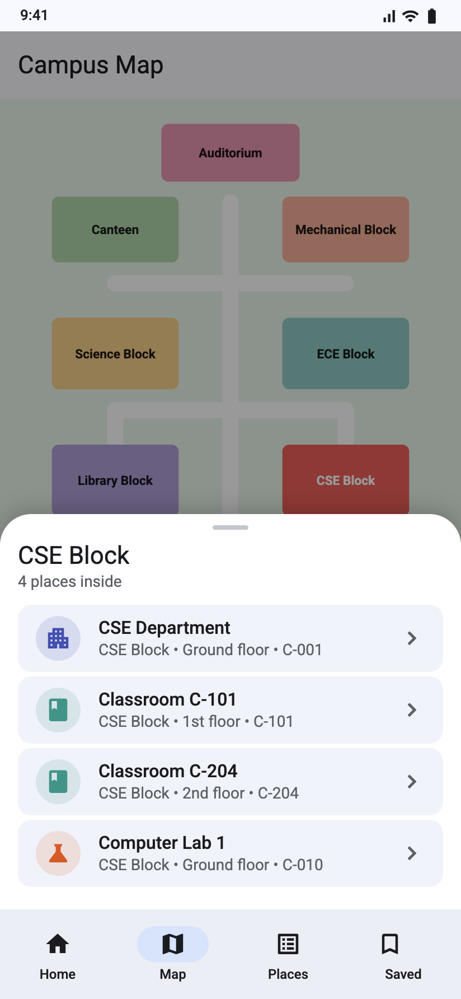
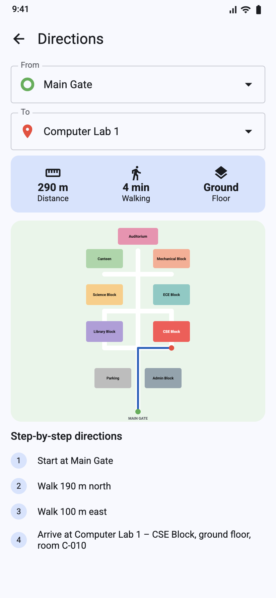
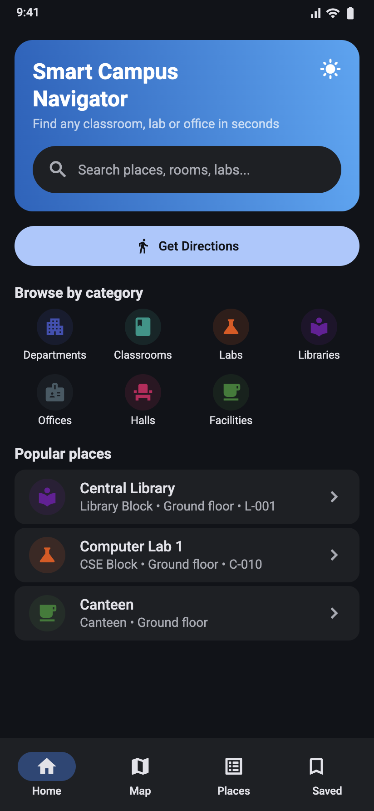

# Smart Campus Navigator

A Flutter app that helps students and visitors find classrooms, labs, departments,
libraries and offices on a college campus using an offline digital map and
step-by-step walking directions.

## Features
- Search places by name, room number or keyword; filter by category
- Interactive campus map (zoom/pan, tap a building to see what is inside)
- Shortest walking route (Dijkstra) with distance, walking time and directions
- Place details: building, floor, room, timings
- Saved places and recently viewed (stored on device), light/dark theme

## Run
```bash
flutter create . --platforms=android,ios,web   # generates platform folders once
flutter pub get
flutter test
flutter run
```

## Screenshots
| Home | Map | Directions | Dark mode |
|---|---|---|---|
|  |  |  |  |

## Project report
See [docs/SmartCampusNavigator_Flutter_Project_Report.pdf](docs/SmartCampusNavigator_Flutter_Project_Report.pdf).

## Author
Arige Navya (24AG1A0503) – B.Tech CSE, ACE Engineering College
