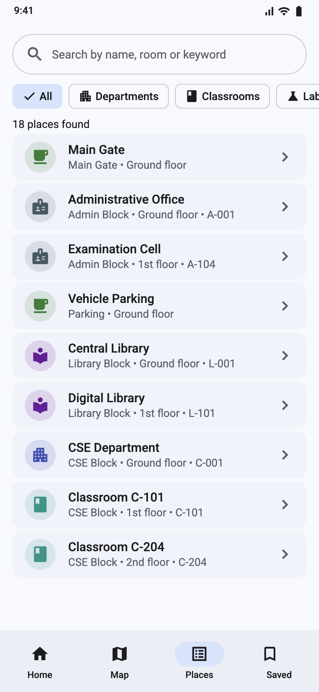
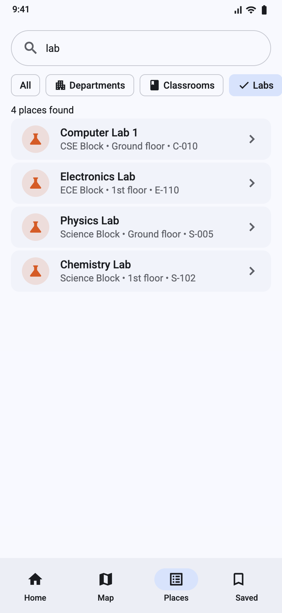
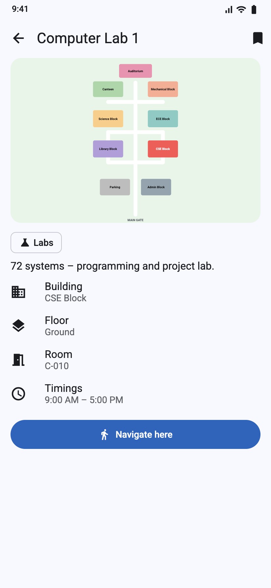
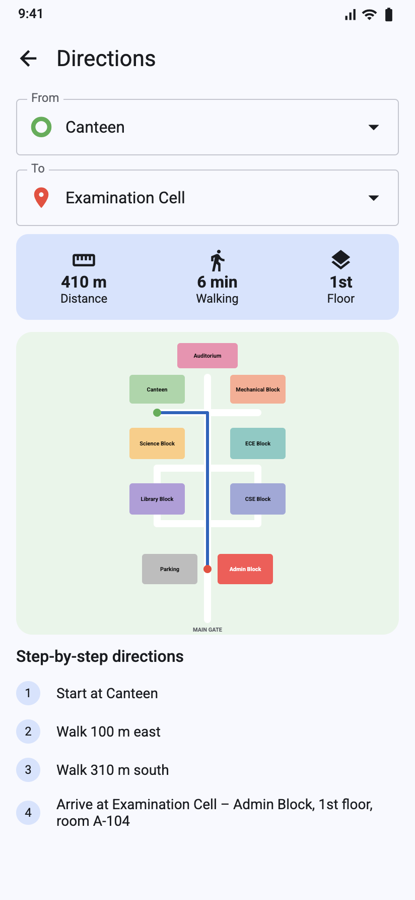
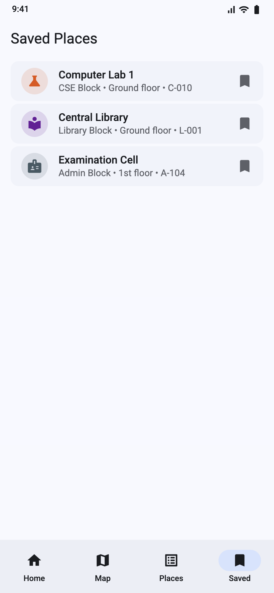
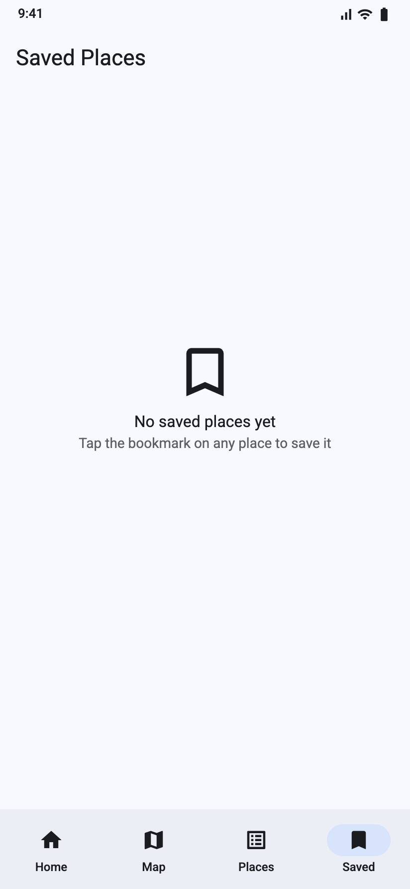

# Smart Campus Navigator

A Flutter app that helps students and visitors find classrooms, labs, departments,
libraries and offices on a college campus using an offline digital map and
step-by-step walking directions.

  

## Features
- Search places by name, room number or keyword; filter by category
- Interactive campus map (zoom/pan, tap a building to see what is inside)
- Shortest walking route (Dijkstra) with distance, walking time and directions
- Place details: building, floor, room, timings
- Saved places and recently viewed (stored on device), light/dark theme

## Screenshots
| Home | All places | Search | Campus map | Place details |
|---|---|---|---|---|
|  |  |  |  |  |

| Directions | Directions (2) | Saved | Empty state | Dark mode |
|---|---|---|---|---|
|  |  |  |  |  |

## Getting started
```bash
git clone https://github.com/navyaarige098-del/Smart-Campus-Navigator.git
cd Smart-Campus-Navigator
flutter create . --platforms=android,ios,web   # generates platform folders once
flutter pub get
flutter run            # or: flutter run -d chrome
```

## Running tests
```bash
flutter analyze
flutter test
```

## Project structure
```
lib/
├── main.dart                 # app entry, light/dark theme
├── models/place.dart         # Place, PlaceCategory, Building
├── data/campus_data.dart     # junctions, roads, buildings, places
├── services/route_service.dart    # Dijkstra shortest path + directions
├── services/storage_service.dart  # shared_preferences
├── state/campus_controller.dart   # ChangeNotifier
├── widgets/                  # campus_map, place_tile
└── screens/                  # home, map, places, detail, directions, saved
test/                         # unit and widget tests
docs/                         # report, screenshots, architecture, guides
```
See [docs/ARCHITECTURE.md](docs/ARCHITECTURE.md) for details.

## Tech stack
Flutter · Dart · Material 3 · CustomPainter · shared_preferences · flutter_test · GitHub Actions

## Project report
[docs/SmartCampusNavigator_Flutter_Project_Report.pdf](docs/SmartCampusNavigator_Flutter_Project_Report.pdf)

## Author
**Arige Navya** (24AG1A0503) – B.Tech CSE, ACE Engineering College, Hyderabad

## License
[MIT](LICENSE)
